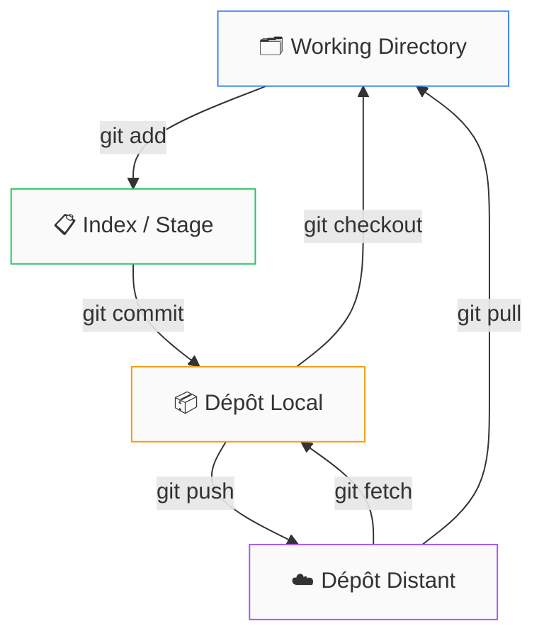
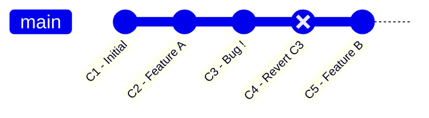
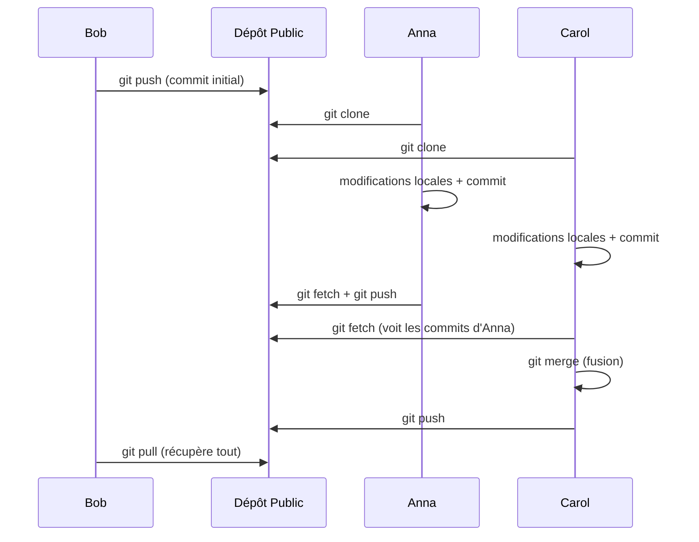
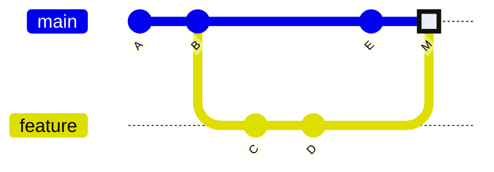
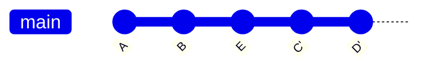
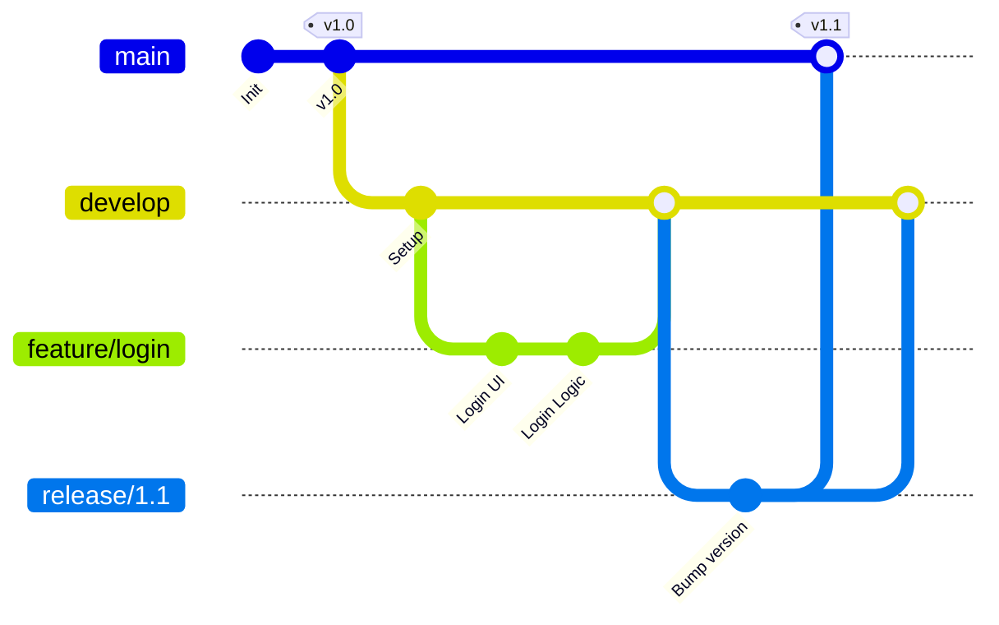
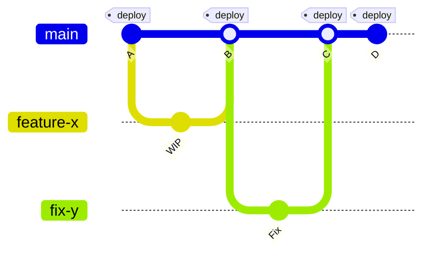
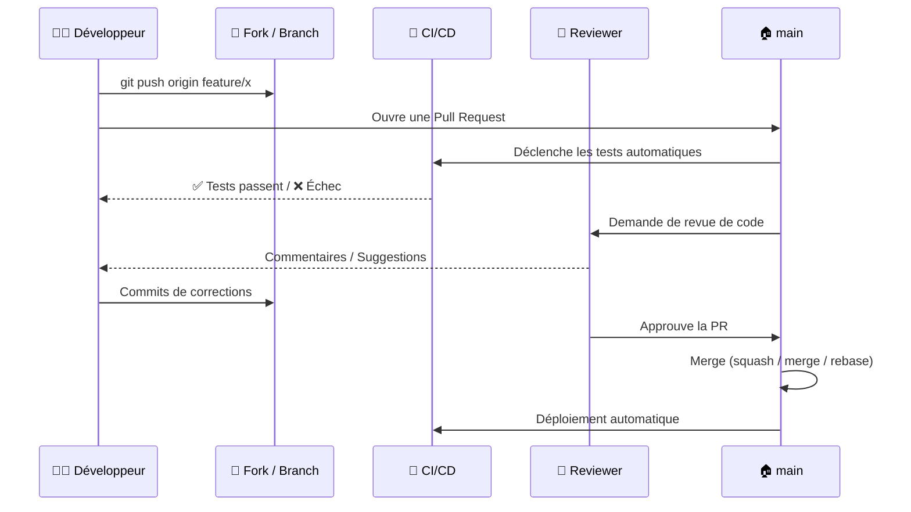

# Gestion de Versions & Git

**De Subversion à GitFlow**

<div class="pt-12">
  <span class="px-2 py-1 rounded cursor-pointer text-sm bg-white/10 hover:bg-white/20">
    Olivier Barais · IRISA / DiverSE · Université de Rennes
  </span>
</div>

<div class="abs-br m-6 flex gap-2">
  <a href="https://github.com/barais" target="_blank" alt="GitHub"
    class="text-xl slidev-icon-btn opacity-50 !border-none !hover:text-white">
    <carbon-logo-github />
  </a>
</div>


---
layout: image
image: /CollaborationInSE.svg
---


---
layout: two-cols-header
class: items-center
---

## Collaboration à l'ère de l'IA agentique


::left::

<div class="p-1 bg-blue-900/20 rounded border border-blue-500/30 text-gray-900 dark:text-white">
<strong class="text-lg">🤔 Question ouverte</strong>
<p class="mt-2 text-gray-700 dark:text-gray-300">Les VCS, les forges, les workflows de PR… ont été conçus pour des <em>humains</em> qui collaborent.</p>
<p class="mt-2 text-gray-700 dark:text-gray-300">Demain, des <strong>agents IA autonomes</strong> contribueront du code, ouvriront des PR, déclencheront des pipelines CI — en parallèle, 24h/24.</p>
</div>

::right::

<div v-click class="ml-8 p-1 bg-orange-900/20 rounded border border-orange-500/30 text-gray-900 dark:text-white">
<strong>🧩 Nouvelles questions</strong>
<ul class="text-sm mt-2 space-y-1 text-gray-700 dark:text-gray-300">
  <li>Qui <em>valide</em> les commits d'un agent ? Comment ?</li>
  <li>Comment <em>tracer</em> la paternité humaine vs IA ?</li>
  <li>Les branches, les PR et les revues sont-elles encore le bon paradigme ?</li>
  <li>Quelle <strong>supply chain</strong> quand le code n'est plus écrit par des humains ?</li>
</ul>
</div>

<div v-click class="absolute bottom-50 left-8 right-8 p-4 bg-purple-900/20 rounded border border-purple-500/30 text-gray-900 dark:text-white text-sm">
<strong>→ Ce cours vous donne les fondations</strong> pour comprendre ces enjeux — et anticiper ce que la pratique n'a pas encore stabilisé.
</div>


---
layout: default
zoom: 0.9
---

## Pourquoi un(e) RSSI doit maîtriser les VCS ?

<div class="grid grid-cols-3 gap-4 mt-4">

<div v-click class="p-4 bg-blue-900/20 rounded border border-blue-500/30 text-gray-900 dark:text-white">
<div class="text-2xl mb-2">🔍</div>
<strong>Traçabilité & audit</strong>
<p class="text-sm mt-2 text-gray-700 dark:text-gray-300">Chaque commit est un événement horodaté et signé. <strong>Qui</strong> a modifié quoi, <strong>quand</strong>, et <strong>pourquoi</strong> — réponse instantanée en cas d'incident ou d'audit de conformité (ISO 27001, PCI-DSS, SOC 2).</p>
<div class="mt-2 p-2 bg-gray-200/80 dark:bg-black/30 rounded font-mono text-xs text-gray-900 dark:text-green-400">
git log --follow -p config/firewall.yaml<br/>
git blame secrets-manager.tf
</div>
</div>

<div v-click class="p-4 bg-orange-900/20 rounded border border-orange-500/30 text-gray-900 dark:text-white">
<div class="text-2xl mb-2">⚙️</div>
<strong>Infrastructure as Code</strong>
<p class="text-sm mt-2 text-gray-700 dark:text-gray-300">Toute configuration (Terraform, Ansible, Kubernetes, règles SIEM…) <strong>vit dans Git</strong>. Toute dérive de configuration est détectable. Toute restauration est reproductible.</p>
<ul class="text-xs mt-2 space-y-1 text-gray-700 dark:text-gray-300">
  <li>🔧 Règles pare-feu versionnées</li>
  <li>🏗️ Infra déployée depuis un dépôt</li>
  <li>📋 Politiques de sécurité en code</li>
  <li>🔄 Rollback en cas de mauvaise config</li>
</ul>
</div>

<div v-click class="p-4 bg-red-900/20 rounded border border-red-500/30 text-gray-900 dark:text-white">
<div class="text-2xl mb-2">🚨</div>
<strong>Réponse aux incidents</strong>
<p class="text-sm mt-2 text-gray-700 dark:text-gray-300">Quand une CVE est publiée ou qu'une backdoor est découverte, le VCS permet de répondre en minutes :</p>
<ul class="text-xs mt-2 space-y-1 text-gray-700 dark:text-gray-300">
  <li>🔎 <code>git log -S "eval("</code> — chercher du code suspect</li>
  <li>📅 Identifier la fenêtre de compromission</li>
  <li>↩️ <code>git revert</code> — annuler proprement</li>
  <li>🏷️ Comparer release avant/après l'incident</li>
</ul>
</div>

</div>

<div class="grid grid-cols-2 gap-4 mt-3">

<div v-click class="p-3 bg-purple-900/20 rounded border border-purple-500/30 text-gray-900 dark:text-white">
<div class="flex items-start gap-3">
<span class="text-2xl">🔐</span>
<div>
<strong>Gestion des secrets & politiques</strong>
<p class="text-sm mt-1 text-gray-700 dark:text-gray-300">Les VCS permettent de détecter les <strong>secrets commités par erreur</strong> (<code>git-secrets</code>, truffleHog, Gitleaks), d'enforcer des hooks de pré-commit, et de versionner les politiques de sécurité comme du code auditable.</p>
</div>
</div>
</div>

<div v-click class="p-3 bg-teal-900/20 rounded border border-teal-500/30 text-gray-900 dark:text-white">
<div class="flex items-start gap-3">
<span class="text-2xl">📦</span>
<div>
<strong>Supply chain & intégrité des livrables</strong>
<p class="text-sm mt-1 text-gray-700 dark:text-gray-300">Les <strong>tags signés GPG</strong>, les commits signés et les SBOMs générés depuis le dépôt permettent de prouver l'intégrité de ce qui est livré en production. Lien direct avec SLSA et la sécurité de la supply chain.</p>
</div>
</div>
</div>

</div>

<div v-click class="mt-3 p-3 bg-gray-900/10 dark:bg-white/5 rounded border border-gray-500/30 text-center text-gray-900 dark:text-white text-sm">
💡 <strong>Pour un(e) RSSI :</strong> le dépôt Git n'est pas un outil de développeur — c'est un <strong>journal d'audit immuable</strong>, une <strong>source de vérité opérationnelle</strong> et le premier maillon de la supply chain à sécuriser.
</div>

<style>
/* style.css */
.slidev-layout.two-cols-header {
  grid-template-columns: 4fr 2fr;
}
p {
  font-size: 0.9em;
  margin-top: 0.5em;
  margin-bottom: 0.5em;
}
</style>


---
layout: default
---

# Plan du module

<div class="grid grid-cols-2 gap-6 mt-4">

<div class="flex flex-col gap-3">

<div v-click class="flex items-start gap-3 p-3 bg-blue-900/20 rounded border border-blue-500/30 text-gray-900 dark:text-white">
  <span class="text-2xl">🤝</span>
  <div>
    <strong class="block">1 — Collaboration logicielle</strong>
    <span class="text-sm text-gray-700 dark:text-gray-300">VCS, forges, CI/CD : les 3 dimensions</span>
  </div>
</div>

<div v-click class="flex items-start gap-3 p-3 bg-blue-900/20 rounded border border-blue-500/30 text-gray-900 dark:text-white">
  <span class="text-2xl">🎯</span>
  <div>
    <strong class="block">2 — Motivations</strong>
    <span class="text-sm text-gray-700 dark:text-gray-300">Pourquoi versionner ? Le chaos sans SCM</span>
  </div>
</div>

<div v-click class="flex items-start gap-3 p-3 bg-green-900/20 rounded border border-green-500/30 text-gray-900 dark:text-white">
  <span class="text-2xl">🗂️</span>
  <div>
    <strong class="block">3 — Les VCS : SVN → Git</strong>
    <span class="text-sm text-gray-700 dark:text-gray-300">Évolution : local, centralisé, distribué</span>
  </div>
</div>

<div v-click class="flex items-start gap-3 p-3 bg-green-900/20 rounded border border-green-500/30 text-gray-900 dark:text-white">
  <span class="text-2xl">🐙</span>
  <div>
    <strong class="block">4 — Git en profondeur</strong>
    <span class="text-sm text-gray-700 dark:text-gray-300">Architecture, 3 zones, commits, historique</span>
  </div>
</div>

<div v-click class="flex items-start gap-3 p-3 bg-purple-900/20 rounded border border-purple-500/30 text-gray-900 dark:text-white">
  <span class="text-2xl">🔀</span>
  <div>
    <strong class="block">5 — Collaboration avec Git</strong>
    <span class="text-sm text-gray-700 dark:text-gray-300">Clone, fetch, push, merge, rebase</span>
  </div>
</div>

</div>

<div class="flex flex-col gap-3">

<div v-click class="flex items-start gap-3 p-3 bg-purple-900/20 rounded border border-purple-500/30 text-gray-900 dark:text-white">
  <span class="text-2xl">✍️</span>
  <div>
    <strong class="block">6 — Messages de commit</strong>
    <span class="text-sm text-gray-700 dark:text-gray-300">Conventional Commits, règles d'or</span>
  </div>
</div>

<div v-click class="flex items-start gap-3 p-3 bg-orange-900/20 rounded border border-orange-500/30 text-gray-900 dark:text-white">
  <span class="text-2xl">🌿</span>
  <div>
    <strong class="block">7 — Branches & GitFlow</strong>
    <span class="text-sm text-gray-700 dark:text-gray-300">Stratégies de branching, TBD vs GitFlow</span>
  </div>
</div>

<div v-click class="flex items-start gap-3 p-3 bg-orange-900/20 rounded border border-orange-500/30 text-gray-900 dark:text-white">
  <span class="text-2xl">🔍</span>
  <div>
    <strong class="block">8 — Pull Requests & Revue</strong>
    <span class="text-sm text-gray-700 dark:text-gray-300">Workflow PR, bonnes pratiques, GPG</span>
  </div>
</div>

<div v-click class="flex items-start gap-3 p-3 bg-teal-900/20 rounded border border-teal-500/30 text-gray-900 dark:text-white">
  <span class="text-2xl">🏭</span>
  <div>
    <strong class="block">9 — Forges logicielles</strong>
    <span class="text-sm text-gray-700 dark:text-gray-300">GitHub/GitLab, CI/CD, outils complémentaires</span>
  </div>
</div>

<div v-click class="flex items-start gap-3 p-3 bg-red-900/20 rounded border border-red-500/30 text-gray-900 dark:text-white">
  <span class="text-2xl">🛡️</span>
  <div>
    <strong class="block">10 — Bonnes pratiques & Supply Chain</strong>
    <span class="text-sm text-gray-700 dark:text-gray-300">Limitations, sécurité, synthèse</span>
  </div>
</div>

</div>
</div>

---
layout: section
---

# Collaboration dans l'ingénierie logicielle

---

## La collaboration dans les projets logiciels

<div class="grid grid-cols-2 gap-8 mt-4">
<div>

**Le défi fondamental :** comment plusieurs développeurs peuvent-ils travailler sur le même code en même temps, sans se marcher dessus ?

<v-clicks>

- 🗂️ **Niveau artefact** — partager et versionner les fichiers sources
- 🤝 **Niveau social** — coordonner les équipes, les revues, les décisions
- 🤖 **Niveau automatisation** — CI/CD pour valider en continu

</v-clicks>

<div v-click class="mt-1 p-1 bg-blue-900/20 rounded border border-blue-500/30 text-sm text-gray-900 dark:text-white">

**Évolution historique :**
- 1985 → VCS (gestion au niveau artefact)
- 2010 → Software Forges (collaboration sociale)
- 2012 → CI/CD (collaboration automatisée)

</div>

</div>
<div class="flex flex-col gap-3">

<div v-click class="p-3 bg-green-900/20 rounded border border-green-500/30 text-gray-900 dark:text-white">
<strong>🗃️ VCS</strong> — <em>Version Control Systems</em><br/>
<span class="text-sm text-gray-700 dark:text-gray-300">Gestion des versions et accès concurrents aux fichiers</span>
</div>

<div v-click class="p-3 bg-purple-900/20 rounded border border-purple-500/30 text-gray-900 dark:text-white">
<strong>🏭 Forges logicielles</strong><br/>
<span class="text-sm text-gray-700 dark:text-gray-300">GitHub, GitLab — réseau social + VCS + CI/CD</span>
</div>

<div v-click class="p-3 bg-orange-900/20 rounded border border-orange-500/30 text-gray-900 dark:text-white">
<strong>⚙️ CI/CD</strong> — Intégration Continue<br/>
<span class="text-sm text-gray-700 dark:text-gray-300">Automatisation : tests, qualité, déploiement</span>
</div>

</div>
</div>

---
layout: section
---

# Motivations : pourquoi la gestion de versions ?

---

## Le chaos sans gestion de versions

<div class="grid grid-cols-2 gap-6 mt-3">
<div>

**Bob prépare un rapport** et crée des sauvegardes manuelles :

<v-clicks>

- 📄 `rapport.doc` ← version initiale
- 📄 `rapport_sauvegarde.doc` ← copie de précaution
- 📄 `rapport_v1.doc` ← envoyé à Anna pour correction
- 📄 `rapport_v2.doc` ← envoyé à Carol pour avis
- 📄 `rapport_v3.doc` ← version finale (en théorie)

</v-clicks>

</div>
<div v-click>

**Le problème :** Bob reçoit des corrections de Anna (sur v1) et de Carol (sur v2), pendant qu'il a continué à travailler sur v3...

```
rapport.doc
rapport_sauvegarde.doc
rapport_v1.doc          ← corrections d'Anna
rapport_v2.doc          ← corrections de Carol
rapport_v3.doc          ← version "finale"
rapport_FINAL.doc
rapport_FINAL_v2.doc
rapport_VRAIMENT_FINAL.doc
```

<div class="mt-2 p-2 bg-red-900/20 rounded border border-red-500/30 text-sm text-gray-900 dark:text-white">
⚠️ Comment intégrer des corrections faites sur des versions antérieures ?
</div>

</div>
</div>

---

## Les 3 dimensions du SCM

**Software Configuration Management** — [Estublier et al. 1995]

<div class="grid grid-cols-3 gap-4 mt-4">

<div v-click class="p-4 bg-blue-900/20 rounded border border-blue-500/30 text-gray-900 dark:text-white">
<div class="text-2xl mb-2">⏱️</div>
<strong>Révision</strong>
<p class="text-sm mt-1 text-gray-700 dark:text-gray-300">Évolution dans le temps. Chaque modification crée une nouvelle version.</p>
</div>

<div v-click class="p-4 bg-green-900/20 rounded border border-green-500/30 text-gray-900 dark:text-white">
<div class="text-2xl mb-2">👥</div>
<strong>Concurrence</strong>
<p class="text-sm mt-1 text-gray-700 dark:text-gray-300">Plusieurs développeurs modifient le même fichier en parallèle.</p>
</div>

<div v-click class="p-4 bg-purple-900/20 rounded border border-purple-500/30 text-gray-900 dark:text-white">
<div class="text-2xl mb-2">🔀</div>
<strong>Variantes</strong>
<p class="text-sm mt-1 text-gray-700 dark:text-gray-300">Plusieurs versions d'un même produit (plateformes, clients, features).</p>
</div>

</div>

<div v-click class="mt-5 p-3 bg-yellow-900/20 rounded border border-yellow-500/30 text-sm text-gray-900 dark:text-white">

**Objectifs d'un VCS :** historiser toutes les versions · gérer les versions concurrentes · gérer les variantes et branches · faciliter la collaboration entre développeurs

</div>

<div v-click class="mt-3 text-xs text-center opacity-50">
Estublier, J. et al. (1995). Software Process: Technology and Experience. Springer.
</div>

---
layout: section
---

# Les systèmes de gestion de versions

---

## Évolution des VCS

<div class="grid grid-cols-3 gap-5 mt-4">

<div v-click class="text-center">

<div class="mt-2 p-2 bg-gray-800/50 rounded text-sm text-gray-900 dark:text-white">
<strong>1. Local (RCS)</strong><br/>
Versionning sur un seul poste.<br/>
<span class="text-red-400 text-xs">Pas de collaboration !</span>
</div>
</div>

<div v-click class="text-center">

<div class="mt-2 p-2 bg-gray-800/50 rounded text-sm text-gray-900 dark:text-white">
<strong>2. Centralisé (SVN)</strong><br/>
Un serveur central partagé.<br/>
<span class="text-yellow-400 text-xs">SPOF, offline impossible</span>
</div>
</div>

<div v-click class="text-center">

<div class="mt-2 p-2 bg-gray-800/50 rounded text-sm text-gray-900 dark:text-white">
<strong>3. Distribué (Git)</strong><br/>
Chaque clone = dépôt complet.<br/>
<span class="text-green-400 text-xs">Offline OK, backup gratuit !</span>
</div>
</div>

</div>

<div v-click class="mt-4 text-xs text-center opacity-50">
Images: Pro Git Book (progit.org) — Scott Chacon & Ben Straub
</div>

---
layout: center
class: text-center
---

# Développement idéal


---
layout: center
class: text-center
---

# Développement idéal


---
layout: center
class: text-center
---

# Développement idéal


---
layout: center
class: text-center
---

# Développement idéal


---
layout: center
class: text-center
---

# Développement réel


---
layout: center
class: text-center
---

# Développement réel


---
layout: center
class: text-center
---

# Développement réel


---
layout: center
class: text-center
---

# Développement réel


---
layout: center
class: text-center
---

# Développement réel


---

## Subversion — Rappels

<div class="grid grid-cols-2 gap-6 mt-3">
<div>

**Modèle client/serveur centralisé :**

<v-clicks>

- **Checkout** — copie privée dans un répertoire local
- **Update** — synchronise la copie locale depuis le serveur
- **Commit** — envoie les modifications au serveur

</v-clicks>

<div v-click class="mt-4">

**Révisions et tags :**
- **Révision** : numéro global incrémenté à chaque commit
- **Tag** : marqueur symbolique sur une révision
- **Branche** : copie du trunk dans `branches/`

</div>

</div>
<div>

<div v-click>

```bash
# Checkout initial
svn checkout svn://server/monprojet

# Modifier un fichier, puis mettre à jour
svn update

# Valider les modifications
svn commit -m "Description du changement"

# Créer un tag
svn copy trunk/ tags/v1.0/

# Voir l'historique
svn log --limit 10
```

</div>

<div v-click class="mt-3 p-2 bg-orange-900/20 rounded border border-orange-500/30 text-sm text-gray-900 dark:text-white">
⚠️ SVN est encore utilisé dans de nombreuses entreprises, mais <strong>Git est devenu le standard</strong> de facto depuis 2010.
</div>

</div>
</div>

---
layout: section
---

# Git — Gestion de versions distribuée

---

## Brève histoire de Git

<div class="grid grid-cols-2 gap-6 mt-4">
<div>

<v-clicks>

- **2002** — Linus Torvalds utilise **BitKeeper** pour le noyau Linux
- **2005** — Problème de licence avec BitKeeper
- **5 avril 2005** — Linus publie le premier email avec Git
- **15 juin 2005** — Git gère le développement du noyau Linux
- **2008** — GitHub est fondé
- **2018** — Microsoft acquiert GitHub pour **7,5 milliards $**
- **Aujourd'hui** — Plus de **100 millions** de dépôts publics

</v-clicks>

</div>
<div>

<div v-click class="p-4 bg-gray-800/50 rounded border border-gray-600/30 text-sm italic text-gray-900 dark:text-white">

*"Never mind merging. It's not an SCM, it's a distribution and archival mechanism. I bet you could make a reasonable SCM on top of it, though."*

— Linus Torvalds, 7 avril 2005

</div>

<div v-click class="mt-4 p-3 bg-blue-900/20 rounded border border-blue-500/30 text-sm text-gray-900 dark:text-white">

**Git n'est pas un SCM au sens traditionnel** — c'est un graphe orienté acyclique de snapshots compressés, avec des opérations de diff/patch très efficaces.

</div>

</div>
</div>

---

## Avantages de Git

<div class="grid grid-cols-2 gap-6 mt-4">
<div>

<v-clicks>

- 🛡️ **Résilience** — Chaque clone est un backup complet. Pas de SPOF.
- ⚡ **Vitesse** — Opérations locales ultra-rapides (log, diff, branch)
- 💾 **Efficacité** — Compression cross-repository, transferts minimisés
- 🔀 **Branching puissant** — Branches légères, merge efficace
- 🔄 **Workflow flexible** — Git n'impose pas de workflow

</v-clicks>

</div>
<div>

<div v-click class="p-3 bg-orange-900/20 rounded border border-orange-500/30 text-gray-900 dark:text-white">
<strong>⚠️ Inconvénients :</strong>
<ul class="text-sm mt-1 space-y-1">
<li>Courbe d'apprentissage plus raide qu'SVN</li>
<li>Concept de staging (index) déroutant au début</li>
<li>Documentation principalement en man pages</li>
</ul>
</div>

<div v-click class="mt-3 p-3 bg-green-900/20 rounded border border-green-500/30 text-gray-900 dark:text-white">
<strong>✅ Fonctions avancées :</strong>
<ul class="text-sm mt-1 space-y-1">
<li><code>git bisect</code> — dichotomie pour trouver un bug</li>
<li><code>git stash</code> — mise de côté temporaire</li>
<li><code>git cherry-pick</code> — appliquer un commit précis</li>
<li><code>git rebase</code> — réécrire l'historique proprement</li>
</ul>
</div>

</div>
</div>

---

## Architecture de Git

<div class="grid grid-cols-2 gap-6 mt-3">
<div>

**Les 4 types d'objets Git :**

<v-clicks>

- **Blob** — contenu d'un fichier, stocké dans `.git/objects/`, indexé par hash SHA-1
- **Tree** — répertoire, liste de blobs et sous-trees
- **Commit** — snapshot + parent + auteur + message
- **Tag** — étiquette pointant sur un commit

</v-clicks>

<div v-click class="mt-4 p-2 bg-blue-900/20 rounded border border-blue-500/30 text-sm text-gray-900 dark:text-white">

**L'Index (staging area)** — zone tampon entre votre working tree et le prochain commit. C'est ce qui rend Git si puissant et flexible.

</div>

</div>
<div>



</div>
</div>

---

## Les 3 zones de Git

<div class="grid grid-cols-3 gap-4 mt-4">

<div v-click class="p-4 bg-blue-900/20 rounded border border-blue-500/30 text-center text-gray-900 dark:text-white">
<div class="text-3xl mb-2">🗂️</div>
<strong>Working Directory</strong>
<p class="text-sm mt-2 text-gray-700 dark:text-gray-300">Les fichiers que vous voyez et modifiez au quotidien. Git les trace mais ne les versionne pas automatiquement.</p>
<div class="mt-2 font-mono text-xs bg-gray-200/80 dark:bg-black/30 p-1 rounded">git status</div>
</div>

<div v-click class="p-4 bg-green-900/20 rounded border border-green-500/30 text-center text-gray-900 dark:text-white">
<div class="text-3xl mb-2">📋</div>
<strong>Index / Stage</strong>
<p class="text-sm mt-2 text-gray-700 dark:text-gray-300">La "scène" — sous-ensemble des fichiers préparés pour le prochain commit. Permet des commits précis et atomiques.</p>
<div class="mt-2 font-mono text-xs bg-gray-200/80 dark:bg-black/30 p-1 rounded">git add &lt;fichier&gt;</div>
</div>

<div v-click class="p-4 bg-orange-900/20 rounded border border-orange-500/30 text-center text-gray-900 dark:text-white">
<div class="text-3xl mb-2">📦</div>
<strong>Repository (.git)</strong>
<p class="text-sm mt-2 text-gray-700 dark:text-gray-300">La base de données Git locale. Contient tous les objets (blobs, trees, commits, tags) compressés.</p>
<div class="mt-2 font-mono text-xs bg-gray-200/80 dark:bg-black/30 p-1 rounded">git commit -m "..."</div>
</div>

</div>

<div v-click class="mt-4 p-3 bg-purple-900/20 rounded border border-purple-500/30 text-sm text-gray-900 dark:text-white">

💡 **Le staging area est une killer feature !** Il permet de préparer des commits propres et atomiques même quand vous avez plusieurs modifications en cours.

</div>

---

## Commits et historique

<div class="grid grid-cols-2 gap-6 mt-3">
<div>

**Un commit = un snapshot + des métadonnées**

<v-clicks>

- Hash SHA-1 unique (ex: `a1b2c3d...`)
- Référence vers le(s) commit(s) parent(s)
- Auteur + date + email
- **Message de validation**
- Pointeur vers le tree (snapshot complet)

</v-clicks>

<div v-click class="mt-3 p-2 bg-blue-900/20 rounded border border-blue-500/30 text-sm text-gray-900 dark:text-white">

Git ne stocke pas des diffs, mais des **snapshots complets** — les diffs sont calculés à la volée. Les fichiers inchangés ne sont pas dupliqués (pointeurs).

</div>

</div>
<div>

<div v-click>

```bash
# Exemple de git log --graph
$ git log --oneline --graph
* a1b2c3d (HEAD -> main) feat: add auth module
* 7f8e9ab fix: resolve login timeout #142
*   3c4d5e6 Merge branch 'feature/oauth'
|\  
| * 1a2b3c4 feat: implement OAuth2 flow
| * 9x8y7z6 chore: add oauth dependencies
|/  
* 5f6g7h8 refactor: extract user service
* 2i3j4k5 Initial commit
```

</div>

<div v-click class="mt-2 p-2 bg-green-900/20 rounded text-sm text-gray-900 dark:text-white">

```bash
# Workflow de base
git add src/auth.ts        # Stage un fichier
git add -p                 # Stage interactif 
                           # (hunk par hunk)
git commit -m "feat: add JWT authentication"
git log --oneline -10      # Historique compact
git show a1b2c3d           # Détail d'un commit
```

</div>

</div>
</div>

---
zoom: 0.8
---
## Exemple : Bob versionne son rapport

<div class="mt-4">

```bash
# Bob initialise son dépôt
git init
git add rapport.doc
git commit -m "Première version"

# Après corrections d'Anna
git add rapport.doc
git commit -m "Prise en compte des commentaires d'Anna"

# Après corrections de Carol
git add rapport.doc
git commit -m "Prise en compte des commentaires de Carol"

# Visualiser l'historique
$ git log rapport.doc
commit 128faba4e961a425962e59b8b0680c442528ed72 (HEAD -> master)
Author: Bob <bob@bob.net>  Date: Wed Jan 31 10:24:19 2018 +0100
    Version envoyée

commit 67ef417b9453f62875780a49d009d4a5215af060
Author: Bob <bob@bob.net>  Date: Wed Jan 31 10:23:39 2018 +0100
    Prise en compte des commentaires de Carol

commit a06254b8278deca2923597da8ea900d714d3870a
Author: Bob <bob@bob.net>  Date: Wed Jan 31 10:22:55 2018 +0100
    Prise en compte des commentaires d'Anna
```

</div>

<div v-click class="mt-3 p-2 bg-green-900/20 rounded border border-green-500/30 text-sm text-gray-900 dark:text-white">

✅ Fini les `rapport_VRAIMENT_FINAL_v3.doc` — l'historique est propre, daté, annoté, et réversible !

</div>

---

## Revenir en arrière

<div class="grid grid-cols-2 gap-6 mt-4">
<div>

**Stratégies de retour arrière :**

<v-clicks>

- **`git revert <hash>`** — Crée un nouveau commit qui annule les changements. **Sûr** pour l'historique partagé.
- **`git reset --soft HEAD~1`** — Annule le commit, garde les fichiers staged
- **`git reset --mixed HEAD~1`** — Annule le commit, unstage les fichiers
- **`git reset --hard HEAD~1`** — ⚠️ Annule le commit ET les modifications

</v-clicks>

</div>
<div>



<div v-click class="mt-3 p-2 bg-yellow-900/20 rounded border border-yellow-500/30 text-sm text-gray-900 dark:text-white">

💡 **Règle d'or** : Ne jamais réécrire l'historique d'une branche partagée (`main`, `develop`). Utilisez `git revert` plutôt que `git reset` sur du code poussé.

</div>

</div>
</div>

---
layout: section
---

# Collaboration avec Git

---
zoom: 0.8
---

## Workflow de collaboration


<div class="mt-4">



</div>

---

## Clone, Fetch, Push, Pull

<div class="grid grid-cols-2 gap-6 mt-3">
<div>

<v-clicks>

- **`git clone <url>`** — Copie complète du dépôt (tous les commits, branches, tags). Crée une référence `origin`.
- **`git fetch`** — Récupère les nouveautés du dépôt distant **sans modifier** le working directory
- **`git merge`** — Fusionne une branche dans la branche courante
- **`git pull`** — Raccourci `fetch` + `merge` (ou `fetch` + `rebase`)
- **`git push`** — Envoie les commits locaux vers le dépôt distant

</v-clicks>

</div>
<div>

```bash
# Cloner un dépôt
git clone https://github.com/org/projet.git

# Récupérer les changements distants
git fetch origin
git merge origin/main
# Ou en une commande :
git pull origin main

# Envoyer ses commits
git push origin feature/ma-feature

# Voir l'état vs le distant
git status
git log origin/main..HEAD   # Commits non poussés
git log HEAD..origin/main   # Commits à récupérer
```

</div>
</div>

---
zoom: 1.4
---

## Merge, Rebase, Fast-Forward

<div class="grid grid-cols-2 gap-5 mt-3">
<div>



<div class="mt-2 p-2 bg-blue-900/20 rounded text-xs text-gray-900 dark:text-white">
<strong>Merge :</strong> Crée un commit de fusion M. Préserve l'historique exact.
</div>

</div>
<div>



<div class="mt-2 p-2 bg-purple-900/20 rounded text-xs text-gray-900 dark:text-white">
<strong>Rebase :</strong> Réapplique les commits C et D sur E. Historique linéaire, plus lisible.
</div>

</div>
</div>

<div v-click class="mt-3 grid grid-cols-2 gap-3 text-sm">

<div class="p-2 bg-green-900/20 rounded border border-green-500/30 text-gray-900 dark:text-white">
✅ <strong>Merge</strong> : pour les branches de feature intégrées dans main (préserve le contexte)
</div>

<div class="p-2 bg-purple-900/20 rounded border border-purple-500/30 text-gray-900 dark:text-white">
✅ <strong>Rebase</strong> : pour nettoyer sa branche locale avant une PR (historique propre)
</div>

</div>

---
layout: section
---

# Messages de commit

---

## Pourquoi les messages de commit comptent

<div class="grid grid-cols-2 gap-6 mt-4">
<div>

**Les messages sont de la documentation** — ils doivent répondre à :

<v-clicks>

- **Pourquoi** ce changement est-il nécessaire ?
- **Quoi** a changé ?
- **Effets secondaires** éventuels ?

</v-clicks>

<div v-click class="mt-4 p-3 bg-yellow-900/20 rounded border border-yellow-500/30 text-sm text-gray-900 dark:text-white">

⚠️ Les messages permettent de comprendre les **raisons** d'un changement. Cette compréhension rend le développement et la collaboration plus efficaces, notamment pour les projets open-source.

</div>

</div>
<div>

<div v-click>

**Mauvais messages :**
```
$ git log --oneline
7f96f57 polishing
147709f Tweaks
22b25e0 fix
```

</div>

<div v-click class="mt-2">

**Bons messages :**
```
$ git log --oneline
5ba3db6 Fix failing CompositePropertySourceTests
84564a0 Rework @PropertySource early parsing logic
e142fd1 Add tests for ImportSelector meta-data
```

</div>

<div v-click class="mt-2 p-2 bg-green-900/20 rounded text-xs text-gray-900 dark:text-white">
Laquelle préféreriez-vous déboguer à 23h un vendredi soir ?
</div>

</div>
</div>

---

## 4 règles d'or pour les messages de commit

<div class="grid grid-cols-2 gap-5 mt-3">

<div v-click class="p-3 bg-blue-900/20 rounded border border-blue-500/30 text-gray-900 dark:text-white">
<strong>I — Séparez objet et corps</strong>
<div class="font-mono text-xs mt-2 bg-gray-200/80 dark:bg-black/30 p-2 rounded">
Short summary (50 chars max)<br/>
<br/>
More detailed explanation if<br/>
necessary. Wrap at 72 chars.<br/>
<br/>
- Bullet points okay<br/>
- Blank line before list
</div>
</div>

<div v-click class="p-3 bg-green-900/20 rounded border border-green-500/30 text-gray-900 dark:text-white">
<strong>II — Objet ≤ 50 caractères, impératif</strong>
<div class="font-mono text-xs mt-2 bg-gray-200/80 dark:bg-black/30 p-2 rounded">
✅ Fix login timeout bug<br/>
✅ Add user authentication<br/>
✅ Refactor database layer<br/>
<br/>
❌ Fixed the bug<br/>
❌ Adding auth (gerondif)
</div>
</div>

<div v-click class="p-3 bg-orange-900/20 rounded border border-orange-500/30 text-gray-900 dark:text-white">
<strong>III — Corps : quoi et pourquoi</strong>
<div class="text-xs mt-2 text-gray-700 dark:text-gray-300">
Expliquez le QUOI et le POURQUOI,<br/>
pas le COMMENT (le code fait ça).<br/>
<br/>
"nova/compute/utils.py makes a<br/>
reference to exception.NotFound,<br/>
however exception has not been imported."
</div>
</div>

<div v-click class="p-3 bg-purple-900/20 rounded border border-purple-500/30 text-gray-900 dark:text-white">
<strong>IV — Utilisez les espaces</strong>
<div class="text-xs mt-2 text-gray-700 dark:text-gray-300">
Structurez le message avec des<br/>
lignes vides entre les paragraphes.<br/>
<br/>
Test mnémotechnique :<br/>
<em>"If applied, this commit will …"</em>
</div>
</div>

</div>

---
zoom: 0.9
---

## Conventions de types de commits

<div class="mt-3 p-2 bg-gray-800/50 rounded text-xs font-mono mb-3 text-gray-900 dark:text-white">
&lt;type&gt;(&lt;scope&gt;): &lt;description&gt; — Convention Angular / Conventional Commits
</div>

<div class="grid grid-cols-2 gap-4">

<div>
<v-clicks>

| Type | Icône | Usage |
|------|-------|-------|
| `feat` | ✨ | Nouvelle fonctionnalité |
| `fix` | 🐛 | Correction de bug |
| `docs` | 📖 | Documentation |
| `style` | 💎 | Style / formatage |
| `refactor` | 📦 | Refactoring |
| `test` | 🚨 | Tests |
| `chore` | 🎫 | Maintenance |
| `perf` | 🚀 | Performance |

</v-clicks>
</div>

<div>

<div v-click class="font-mono text-xs bg-gray-200/80 dark:bg-black/30 p-3 rounded">

```
feat(auth): implement OAuth2 login

Add Google and GitHub OAuth2 providers.
Closes #145.

BREAKING CHANGE: The /login endpoint
now requires a 'provider' parameter.
```

</div>

<div v-click class="mt-3 font-mono text-xs bg-gray-200/80 dark:bg-black/30 p-2 rounded">

```
# Exemples réels (projet Angular)
perf(ivy): remove unused argument (#34969)
fix(localize): re-enable code-frame (#34994)
docs: add link to ivy publish guide (#34986)
```

</div>

</div>
</div>

---
layout: section
---

# Branches et GitFlow

---

## Les branches Git

<div class="grid grid-cols-2 gap-6 mt-3">
<div>

**Une branche = un pointeur léger sur un commit**

<v-clicks>

- Créer une branche est **instantané** (≠ SVN qui copie des fichiers)
- Chaque branche évolue indépendamment
- Fusion possible à tout moment (`merge` ou `rebase`)
- Les branches sont locales par défaut

</v-clicks>

<div v-click class="mt-4 p-2 bg-blue-900/20 rounded text-sm text-gray-900 dark:text-white">

```bash
# Créer et basculer sur une branche
git checkout -b feature/auth
# Équivalent moderne
git switch -c feature/auth
# Lister les branches
git branch -a
# Fusionner dans main
git checkout main
git merge feature/auth
# Supprimer la branche
git branch -d feature/auth
```

</div>

</div>
<div>



</div>
</div>

<style>
/* style.css */
li {
  font-size: 0.9em;
  margin-top: 0em;
  margin-bottom: 0em;
}
</style>


---

## GitFlow — Le workflow standard

<div class="grid grid-cols-2 gap-5 mt-3">
<div>

**5 types de branches :**

<v-clicks>

- 🏠 **`main`** — Code en production, tags de version
- 🔧 **`develop`** — Intégration continue des features
- ✨ **`feature/*`** — Nouvelles fonctionnalités (depuis develop)
- 🚀 **`release/*`** — Préparation d'une release (depuis develop)
- 🔥 **`hotfix/*`** — Corrections urgentes (depuis main)

</v-clicks>

<div v-click class="mt-3 p-2 bg-green-900/20 rounded border border-green-500/30 text-sm text-gray-900 dark:text-white">

**Objectifs de GitFlow :**
- Historique propre et lisible
- Isoler les développements en cours
- Support des releases parallèles
- Faciliter les revues de code

</div>

</div>
<div>

<div v-click>

</div>

</div>
</div>

<style>
/* style.css */
p {
  font-size: 0.9em;
  margin-top: 0.2em;
  margin-bottom: 0.2em;
}
li {
  font-size: 0.9em;
  margin-top: 0.2em;
  margin-bottom: 0.2em;
}
</style>


---

## GitFlow en pratique

<div class="grid grid-cols-2 gap-5 mt-3">
<div>

```bash
# Installer git-flow (optionnel)
# apt install git-flow

# Initialiser GitFlow
git flow init

# Démarrer une feature
git flow feature start user-auth
# → crée feature/user-auth depuis develop

# Terminer la feature
git flow feature finish user-auth
# → merge dans develop, supprime la branche

# Démarrer une release
git flow release start 2.0.0
# → crée release/2.0.0 depuis develop
git flow release finish 2.0.0
# → merge dans main ET develop, crée tag v2.0.0
```

</div>
<div>

```bash
# Hotfix urgent en production
git flow hotfix start security-patch
# → crée hotfix/security-patch depuis main

# Corriger le bug...
git flow hotfix finish security-patch
# → merge dans main ET develop, tag

# Sans git-flow (à la main)
git checkout -b feature/auth develop
# ... travail ...
git checkout develop
git merge --no-ff feature/auth
git branch -d feature/auth
git push origin develop
```

<div v-click class="mt-2 p-2 bg-orange-900/20 rounded border border-orange-500/30 text-xs text-gray-900 dark:text-white">
⚠️ GitFlow peut être lourd pour des petites équipes. Évaluez aussi <strong>Trunk-Based Development</strong> pour du déploiement continu.
</div>

</div>
</div>

---
zoom: 1.2
---

## Trunk-Based Development

<div class="grid grid-cols-2 gap-6 mt-3">
<div>

**Alternative à GitFlow pour le CI/CD :**

<v-clicks>

- **Une seule branche principale** : `main` (le "trunk")
- Branches de feature **courtes** (< 2 jours)
- Merge fréquents dans main
- **Feature flags** pour les fonctionnalités en cours
- Déploiement continu depuis main

</v-clicks>

<div v-click class="mt-3 p-2 bg-green-900/20 rounded border border-green-500/30 text-sm text-gray-900 dark:text-white">

✅ Favorise l'intégration continue réelle, réduit l'enfer du merge, idéal avec CI/CD automatisé.

</div>

</div>
<div>



<div v-click class="mt-2 p-2 bg-blue-900/20 rounded text-xs text-gray-900 dark:text-white">

**Comparaison :**
- GitFlow : adapté aux releases versionnées, projets mobiles
- TBD : adapté au SaaS, CI/CD continu, microservices

</div>

</div>
</div>

<style>
/* style.css */
p {
  font-size: 0.9em;
  margin-top: 0.2em;
  margin-bottom: 0.2em;
}
li {
  font-size: 0.9em;
  margin-top: 0.2em;
  margin-bottom: 0.2em;
}
</style>


---
layout: section
---

# Pull Requests & Revue de code

---
zoom: 0.9
---

## Workflow Pull Request / Merge Request

<div class="mt-3">



</div>

---

## Bonnes pratiques de Pull Request

<div class="grid grid-cols-2 gap-5 mt-3">
<div>

**Une bonne PR :**

<v-clicks>

- 📏 **Petite et focalisée** — une PR = une fonctionnalité / un bug
- 📝 **Description claire** — contexte, changements, comment tester
- 🔗 **Liée à un ticket** — `Closes #142`, `Fixes #67`
- ✅ **Tests inclus** — pas de PR sans tests (si applicable)
- 🎨 **Code propre** — lint passant, pas de code mort

</v-clicks>

</div>
<div>

<div v-click class="font-mono text-xs bg-gray-200/80 dark:bg-black/30 p-3 rounded">

```markdown
## Description
Implémente l'authentification OAuth2 avec Google.

## Changements
- Ajout du provider Google OAuth2
- Nouveau endpoint /auth/google/callback
- Mise à jour de la doc API

## Tests
- [ ] Tests unitaires ajoutés
- [ ] Tests d'intégration passants
- [ ] Testé manuellement en staging
Closes #145
```

</div>

<div v-click class="mt-2 p-2 bg-purple-900/20 rounded text-xs text-gray-900 dark:text-white">

**Lier commits et tickets :**
```bash
git commit -m "fix: resolve login timeout

Fixes #142
See-also: #139"
```

</div>

</div>
</div>

<style>
/* style.css */
p {
  font-size: 0.9em;
  margin-top: 0em;
  margin-bottom: 0.2em;
}
li {
  font-size: 0.9em;
  margin-top: 0.2em;
  margin-bottom: 0.2em;
}
</style>


---
zoom: 0.92
---

## Signature GPG des commits

<div class="grid grid-cols-2 gap-6 mt-4">
<div>

**Pourquoi signer ses commits ?**

<v-clicks>

- Garantit que **vous** avez bien fait le commit (non-répudiation)
- Protection contre l'usurpation d'identité Git
- Requis dans certains projets open-source (Linux kernel)
- Badge ✅ "Verified" sur GitHub/GitLab

</v-clicks>

<div v-click class="mt-3 p-2 bg-blue-900/20 rounded text-sm text-gray-900 dark:text-white">

```bash
# Générer une clé GPG
gpg --full-generate-key

# Configurer Git
git config --global user.signingkey <KEY_ID>
git config --global commit.gpgsign true

# Signer un commit
git commit -S -m "feat: add secure module"

# Vérifier la signature
git log --show-signature
```

</div>

</div>
<div>

<div v-click class="p-3 bg-green-900/20 rounded border border-green-500/30 text-gray-900 dark:text-white">
<strong>✅ Sur GitHub :</strong>
<div class="text-sm mt-1">Paramètres → SSH and GPG keys → New GPG key<br/>Les commits apparaissent avec <code class="bg-green-900/50 px-1 rounded text-gray-900 dark:text-white">✓ Verified</code></div>
</div>

<div v-click class="mt-3 p-3 bg-orange-900/20 rounded border border-orange-500/30 text-sm text-gray-900 dark:text-white">
<strong>⚠️ Lien avec la supply chain :</strong><br/>
La signature des commits est un élément clé de la sécurité de la chaîne d'approvisionnement logicielle (SLSA, Sigstore). Un commit non signé ne prouve pas l'identité de l'auteur.
</div>

<div v-click class="mt-3 p-2 bg-purple-900/20 rounded text-xs text-gray-900 dark:text-white">
<strong>Alternative moderne : Sigstore / gitsign</strong><br/>
Signature basée sur OIDC (votre compte GitHub/Google), sans gestion de clés GPG.
</div>

</div>
</div>

---
layout: section
---

# Forges logicielles & Outils complémentaires

---

## GitHub — Plus qu'un simple hébergeur Git

<div class="grid grid-cols-2 gap-6 mt-3">
<div>

**GitHub = réseau social pour développeurs**

<v-clicks>

- 🌟 **Stars** — popularité d'un projet
- 🍴 **Fork** — copie personnelle pour contribuer
- 👥 **Follow** — suivre des développeurs
- 💬 **Issues** — suivi de bugs et features
- 🔁 **Pull Requests** — revue et intégration de code
- 📊 **Insights** — métriques du projet
- 🤖 **GitHub Actions** — CI/CD intégré
- 📦 **Packages** — registry Maven/npm/Docker

</v-clicks>

</div>
<div>

<div v-click>

</div>

<div v-click class="mt-3 p-2 bg-blue-900/20 rounded border border-blue-500/30 text-sm text-gray-900 dark:text-white">

**Alternatives :**
- 🦊 **GitLab** — open-source, self-hosted possible, CI/CD puissant
- 🪣 **Bitbucket** — intégré avec Jira / Atlassian
- 🔧 **Gitea** — forge légère self-hosted
- 🏭 **Forge ISTIC** — forge locale de l'université

</div>

</div>
</div>

<style>
/* style.css */
p {
  font-size: 1em;
  margin-top: 0em;
  margin-bottom: 0.2em;
}
li {
  font-size: 1em;
  margin-top: 0.2em;
  margin-bottom: 0.2em;
}
</style>


---

## Intégration Continue (CI/CD)

<div class="grid grid-cols-2 gap-5 mt-3">
<div>

**Un robot surveille votre dépôt :**

<v-clicks>

- Déclenché à chaque push / PR
- **Compilation** du code
- **Tests** unitaires, intégration, E2E
- **Métriques** de qualité (couverture, dette)
- **Analyse de sécurité** (SAST, SCA)
- **Déploiement** automatique (CD)
- **Notification** en cas d'échec

</v-clicks>

</div>
<div>

<div v-click class="font-mono text-xs bg-gray-200/80 dark:bg-black/30 p-3 rounded">

```yaml
# .github/workflows/ci.yml
name: CI

on: [push, pull_request]

jobs:
  test:
    runs-on: ubuntu-latest
    steps:
      - uses: actions/checkout@v4
      - name: Setup Node
        uses: actions/setup-node@v4
        with:
          node-version: '20'
      - run: npm ci
      - run: npm test
      - run: npm run lint
      - name: Security audit
        run: npm audit --audit-level high
```

</div>

</div>
</div>

---

## Outils complémentaires

<div class="grid grid-cols-2 gap-5 mt-3">

<div v-click class="p-3 bg-blue-900/20 rounded border border-blue-500/30 text-gray-900 dark:text-white">
<strong>🐛 Gestion de bugs / tickets</strong>
<p class="text-sm mt-1 text-gray-700 dark:text-gray-300">Jira, GitHub Issues, GitLab Issues — Lien entre commits et tickets via les mots-clés (<code>Closes #42</code>)</p>
</div>

<div v-click class="p-3 bg-green-900/20 rounded border border-green-500/30 text-gray-900 dark:text-white">
<strong>🔨 Outils de build</strong>
<p class="text-sm mt-1 text-gray-700 dark:text-gray-300">Maven, Gradle, Make, CMake — Compilation, tests, packaging, gestion des dépendances</p>
</div>

<div v-click class="p-3 bg-orange-900/20 rounded border border-orange-500/30 text-gray-900 dark:text-white">
<strong>📦 Registre de binaires</strong>
<p class="text-sm mt-1 text-gray-700 dark:text-gray-300">Maven Central, npm, PyPI, Docker Hub — Dépendances binaires plutôt que sources, gestion de versions</p>
</div>

<div v-click class="p-3 bg-purple-900/20 rounded border border-purple-500/30 text-gray-900 dark:text-white">
<strong>🔍 Qualité de code</strong>
<p class="text-sm mt-1 text-gray-700 dark:text-gray-300">SonarQube, CodeClimate — Métriques de qualité, dette technique, duplication, complexité cyclomatique</p>
</div>

</div>

<div v-click class="mt-3 p-2 bg-yellow-900/20 rounded border border-yellow-500/30 text-sm text-gray-900 dark:text-white">

💡 Ces outils sont complémentaires au VCS — ils ne se substituent pas à une **bonne organisation** du projet et à des **conventions claires** de travail.

</div>

---
layout: section
---

# Bonnes pratiques & Conclusion

---

## Conseils pratiques

<div class="grid grid-cols-2 gap-5 mt-3">
<div>

**Pour les individus :**

<v-clicks>

- ✅ **Ne pas utiliser de VCS est une faute professionnelle**
- 🔄 Synchroniser souvent (pull fréquents)
- 📏 Commits petits et atomiques
- 📝 Messages de commit clairs et descriptifs
- 🏷️ Toujours tagger les versions distribuées
- 🔒 Travailler sur des branches, jamais directement sur `main`

</v-clicks>

</div>
<div>

**Pour les équipes :**

<v-clicks>

- 📋 Définir et documenter un workflow Git (GitFlow, TBD...)
- 🤖 CI obligatoire sur toutes les branches
- 👀 Revue de code systématique via PR
- 🌿 Branches fonctionnelles séparées par domaine
- 📦 Versionner également les fichiers de configuration, les IaC
- ⚠️ Éviter les fichiers binaires dans Git (utiliser LFS ou un registry)

</v-clicks>

</div>
</div>

---

## Limitations des VCS

<div class="grid grid-cols-2 gap-6 mt-4">
<div>

**Ce que Git ne fait PAS bien :**

<v-clicks>

- 📄 **Fichiers binaires** — Pas de merge intelligent (Word, images, PDF). Git LFS pour les grands fichiers.
- 🔀 **Diff sémantique** — Git compare syntaxiquement les fichiers. Un refactoring de code ne sera pas reconnu comme un déplacement.
- 🗄️ **Données volumineuses** — Les datasets ML, les assets médias → préférer DVC, Git LFS
- 🔐 **Secrets** — Ne JAMAIS commiter des mots de passe ou clés API (utiliser des variables d'environnement)

</v-clicks>

</div>
<div>

<div v-click class="p-3 bg-red-900/20 rounded border border-red-500/30 text-gray-900 dark:text-white">
<strong>🚨 Pièges classiques :</strong>
<ul class="text-sm mt-2 space-y-1">
<li>Commiter <code>.env</code> avec des secrets</li>
<li>Travailler longtemps sans synchroniser</li>
<li>Ne pas définir de <code>.gitignore</code></li>
<li>Force-push sur une branche partagée</li>
<li>Commits trop gros "WIP" sans atomicité</li>
</ul>
</div>

<div v-click class="mt-3 p-2 bg-green-900/20 rounded border border-green-500/30 text-sm text-gray-900 dark:text-white">

**Outils de protection :**
- `git-secrets` / `truffleHog` — détection de secrets
- `pre-commit` hooks — vérifications avant commit
- Branch protection rules sur GitHub/GitLab

</div>

</div>
</div>

---

## Résumé des commandes Git essentielles

<div class="grid grid-cols-3 gap-3 mt-3 text-xs font-mono">

<div class="p-2 bg-gray-300/50 rounded text-gray-900 dark:text-white">
<div class="text-green-400 font-bold mb-1 text-sm">📂 Initialisation</div>

```bash
git init
git clone <url>
git remote add origin <url>
```

</div>

<div class="p-2 bg-gray-300/50 rounded text-gray-900 dark:text-white">
<div class="text-blue-400 font-bold mb-1 text-sm">📝 Staging & Commit</div>

```bash
git status
git add <file>
git add -p   # interactif
git commit -m "msg"
# modifier dernier
git commit --amend  
```

</div>

<div class="p-2 bg-gray-300/50 rounded text-gray-900 dark:text-white">
<div class="text-orange-400 font-bold mb-1 text-sm">🌿 Branches</div>

```bash
git branch -a
git switch -c feat/x
git merge feat/x
git rebase main
git branch -d feat/x
```

</div>

<div class="p-2 bg-gray-300/50 rounded text-gray-900 dark:text-white">
<div class="text-purple-400 font-bold mb-1 text-sm">🔄 Synchronisation</div>

```bash
git fetch origin
git pull origin main
git push origin feat/x
git push -u origin main
```

</div>

<div class="p-2 bg-gray-300/50 rounded text-gray-900 dark:text-white">
<div class="text-yellow-400 font-bold mb-1 text-sm">🔍 Inspection</div>

```bash
git log --oneline --graph
git diff HEAD~1
git blame <file>
git bisect start
git stash / git stash pop
```

</div>

<div class="p-2 bg-gray-300/50 rounded text-gray-900 dark:text-white">
<div class="text-red-400 font-bold mb-1 text-sm">↩️ Annuler</div>

```bash
git revert <hash>    # sûr
git reset --soft HEAD~1
git reset --hard HEAD~1
git restore <file>  # discard
git clean -fd      # ⚠️
```

</div>

</div>

---

## Ressources pour aller plus loin

<div class="grid grid-cols-2 gap-5 mt-4">

<div v-click class="p-3 bg-blue-900/20 rounded border border-blue-500/30 text-gray-900 dark:text-white">
<strong>📚 À lire absolument</strong>
<ul class="text-sm mt-2 space-y-1">
<li>🌐 <a href="https://git-scm.com/book/fr/v2" class="text-blue-400">Pro Git Book</a> (gratuit, en français)</li>
<li>🌐 <a href="https://learngitbranching.js.org/?locale=fr_FR" class="text-blue-400">Learn Git Branching</a> (interactif)</li>
<li>🌐 <a href="https://chris.beams.io/posts/git-commit/" class="text-blue-400">How to Write a Git Commit Message</a></li>
<li>🌐 <a href="https://www.conventionalcommits.org/fr/v1.0.0/" class="text-blue-400">Conventional Commits</a></li>
</ul>
</div>

<div v-click class="p-3 bg-green-900/20 rounded border border-green-500/30 text-gray-900 dark:text-white">
<strong>🛠️ Outils recommandés</strong>
<ul class="text-sm mt-2 space-y-1">
<li>⚡ <a href="https://magit.vc/" class="text-green-400">Magit</a> — Interface Git pour Emacs</li>
<li>🎨 <a href="https://www.gitkraken.com/" class="text-green-400">GitKraken</a> — GUI visuel</li>
<li>📊 <a href="https://desktop.github.com/" class="text-green-400">GitHub Desktop</a> — Simple et efficace</li>
<li>🔧 VS Code + GitLens extension</li>
</ul>
</div>

<div v-click class="p-3 bg-purple-900/20 rounded border border-purple-500/30 text-gray-900 dark:text-white">
<strong>🔀 Workflows à explorer</strong>
<ul class="text-sm mt-2 space-y-1">
<li>📐 <a href="https://nvie.com/posts/a-successful-git-branching-model/" class="text-purple-400">GitFlow original (Vincent Driessen)</a></li>
<li>🚀 <a href="https://trunkbaseddevelopment.com/" class="text-purple-400">Trunk Based Development</a></li>
<li>🐙 <a href="https://docs.github.com/fr/get-started/using-github/github-flow" class="text-purple-400">GitHub Flow</a></li>
</ul>
</div>

<div v-click class="p-3 bg-orange-900/20 rounded border border-orange-500/30 text-gray-900 dark:text-white">
<strong>🔐 Sécurité de la supply chain</strong>
<ul class="text-sm mt-2 space-y-1">
<li>🔑 <a href="https://docs.sigstore.dev/" class="text-orange-400">Sigstore / gitsign</a></li>
<li>🏆 <a href="https://slsa.dev/" class="text-orange-400">SLSA Framework</a></li>
<li>🔒 <a href="https://pre-commit.com/" class="text-orange-400">pre-commit hooks</a></li>
</ul>
</div>

</div>

---
layout: section
---

# 🎬 Démo Live — Git en équipe

---
layout: default
zoom: 0.9
---

## Scénario de démo — Projet `calculator` (1/2)

<div class="grid grid-cols-2 gap-6 mt-2">

<div class="flex flex-col gap-2 text-sm">

<div class="p-3 bg-blue-900/20 rounded border border-blue-500/30 text-gray-900 dark:text-white">
<strong>🎯 Contexte</strong><br/>
<span class="text-gray-700 dark:text-gray-300">Alice (dev) et Bob (reviewer) collaborent sur un micro-projet Python. On joue le workflow complet : init → feature → PR → merge → conflit → rollback.</span>
</div>

<div v-click class="p-3 bg-green-900/20 rounded border border-green-500/30 text-gray-900 dark:text-white">
<strong>① Init & premier commit</strong>
<div class="mt-1 p-2 bg-gray-200/80 dark:bg-black/30 rounded font-mono text-xs">
<span class="text-green-600 dark:text-green-400"># Créer et initialiser le dépôt</span><br/>
mkdir calculator && cd calculator<br/>
git init<br/>
echo "# Calculator" > README.md<br/>
<span class="text-green-600 dark:text-green-400"># Créer calculator.py avec add()</span><br/>
git add .<br/>
git commit -m "feat: initial project setup"<br/>
git log --oneline
</div>
</div>

<div v-click class="p-3 bg-green-900/20 rounded border border-green-500/30 text-gray-900 dark:text-white">
<strong>② Branch feature + commit</strong>
<div class="mt-1 p-2 bg-gray-200/80 dark:bg-black/30 rounded font-mono text-xs">
<span class="text-green-600 dark:text-green-400"># Alice crée sa branche</span><br/>
git switch -c feature/multiply<br/>
<span class="text-green-600 dark:text-green-400"># Ajoute multiply() dans calculator.py</span><br/>
git add calculator.py<br/>
git commit -m "feat(calc): add multiply function"<br/>
git log --oneline --graph --all
</div>
</div>

</div>

<div class="flex flex-col gap-2 text-sm">

<div v-click class="p-3 bg-orange-900/20 rounded border border-orange-500/30 text-gray-900 dark:text-white">
<strong>③ Pendant ce temps… conflit sur main</strong>
<div class="mt-1 p-2 bg-gray-200/80 dark:bg-black/30 rounded font-mono text-xs">
<span class="text-orange-600 dark:text-orange-400"># Bob modifie aussi calculator.py sur main</span><br/>
git switch main<br/>
<span class="text-orange-600 dark:text-orange-400"># Modifie la fonction add() (docstring)</span><br/>
git commit -am "docs: add docstring to add()"<br/>
git log --oneline --graph --all
</div>
</div>

</div>
</div>

---
layout: default
zoom: 0.9
---

## Scénario de démo — Projet `calculator` (2/2)

<div class="grid grid-cols-2 gap-6 mt-2">

<div class="flex flex-col gap-2 text-sm">

<div v-click class="p-3 bg-orange-900/20 rounded border border-orange-500/30 text-gray-900 dark:text-white">
<strong>④ Merge & résolution de conflit</strong>
<div class="mt-1 p-2 bg-gray-200/80 dark:bg-black/30 rounded font-mono text-xs">
<span class="text-orange-600 dark:text-orange-400"># Alice revient sur sa branche</span><br/>
git switch feature/multiply<br/>
git merge main<br/>
<span class="text-red-600 dark:text-red-400"># ⚠️ CONFLICT in calculator.py</span><br/>
<span class="text-orange-600 dark:text-orange-400"># Ouvrir, choisir les deux versions</span><br/>
git add calculator.py<br/>
git commit -m "merge: resolve conflict with main"
</div>
</div>

<div v-click class="p-3 bg-purple-900/20 rounded border border-purple-500/30 text-gray-900 dark:text-white">
<strong>⑤ Simuler une PR (en local)</strong>
<div class="mt-1 p-2 bg-gray-200/80 dark:bg-black/30 rounded font-mono text-xs">
<span class="text-purple-600 dark:text-purple-400"># Revue : vérifier le diff</span><br/>
git diff main..feature/multiply<br/>
git log main..feature/multiply --oneline<br/>
<span class="text-purple-600 dark:text-purple-400"># Bob approuve, merge dans main</span><br/>
git switch main<br/>
git merge --no-ff feature/multiply \<br/>
  -m "feat: merge multiply feature (#1)"<br/>
git branch -d feature/multiply
</div>
</div>

</div>

<div class="flex flex-col gap-2 text-sm">

<div v-click class="p-3 bg-red-900/20 rounded border border-red-500/30 text-gray-900 dark:text-white">
<strong>⑥ Oups — rollback !</strong>
<div class="mt-1 p-2 bg-gray-200/80 dark:bg-black/30 rounded font-mono text-xs">
<span class="text-red-600 dark:text-red-400"># Bug découvert en prod !</span><br/>
git log --oneline<br/>
<span class="text-red-600 dark:text-red-400"># Annuler proprement (historique préservé)</span><br/>
git revert HEAD -m 1<br/>
git log --oneline --graph<br/>
<span class="text-green-600 dark:text-green-400"># ✅ Revert commit = sécurité</span>
</div>
</div>

<div v-click class="p-3 bg-teal-900/20 rounded border border-teal-500/30 text-gray-900 dark:text-white">
<strong>⑦ Inspecter l'historique</strong>
<div class="mt-1 p-2 bg-gray-200/80 dark:bg-black/30 rounded font-mono text-xs">
git log --oneline --graph --all<br/>
git diff HEAD~2 HEAD -- calculator.py<br/>
git blame calculator.py<br/>
<span class="text-teal-600 dark:text-teal-400"># Qui a écrit cette ligne ? Quand ?</span><br/>
git show HEAD:calculator.py
</div>
</div>

</div>
</div>

---
layout: center
class: text-center
zoom: 0.9
---

# Synthèse

<div class="grid grid-cols-3 gap-6 mt-6 text-left">

<div v-click class="p-4 bg-blue-900/20 rounded border border-blue-500/30 text-gray-900 dark:text-white">
<div class="text-2xl mb-2 text-center">🗂️</div>
<strong>VCS</strong>
<p class="text-sm mt-1 text-gray-700 dark:text-gray-300">Git = standard industriel. 3 zones (working, stage, repo). Commits atomiques avec messages clairs.</p>
</div>

<div v-click class="p-4 bg-green-900/20 rounded border border-green-500/30 text-gray-900 dark:text-white">
<div class="text-2xl mb-2 text-center">🌿</div>
<strong>Branches & Workflow</strong>
<p class="text-sm mt-1 text-gray-700 dark:text-gray-300">GitFlow pour les releases versionnées, TBD pour le déploiement continu. Les PR sont le point de contrôle qualité.</p>
</div>

<div v-click class="p-4 bg-purple-900/20 rounded border border-purple-500/30 text-gray-900 dark:text-white">
<div class="text-2xl mb-2 text-center">🤝</div>
<strong>Collaboration</strong>
<p class="text-sm mt-1 text-gray-700 dark:text-gray-300">Forges (GitHub/GitLab) + CI/CD + revue de code = pipeline de qualité complet. Lien commits ↔ tickets.</p>
</div>

</div>

<div v-click class="mt-8 p-4 bg-orange-900/20 rounded border border-orange-500/30 text-gray-900 dark:text-white">
<strong>🔐 Lien avec la supply chain :</strong> La gestion de versions est la première ligne de défense. Commits signés, branches protégées, CI obligatoire, audit des dépendances = sécurité dès le développement.
</div>

<div v-click class="mt-4 p-4 bg-blue-900/20 rounded border border-blue-500/30 text-gray-900 dark:text-white">
<strong>🏗️ Versionner bien plus que le code — GitOps</strong>
<p class="text-sm mt-1 text-gray-700 dark:text-gray-300">Git ne sert pas qu'au code : on peut y versionner l'<strong>infrastructure</strong> (IaC : Terraform, Ansible, Kubernetes), les <strong>configurations</strong> et les <strong>politiques</strong> (sécurité, réseau, observabilité). C'est l'idée du <strong>GitOps</strong> : Git devient la source de vérité unique de l'état <em>désiré</em> du système, et des pipelines appliquent cet état automatiquement, de façon auditable et reproductible.</p>
</div>

---
layout: end
---

# Questions ?

<div class="pt-4 text-gray-600 dark:text-gray-400 text-sm">

**Olivier Barais** · IRISA / DiverSE · Université de Rennes

📧 olivier.barais@irisa.fr · 🌐 [irisa.fr](https://www.irisa.fr)

</div>

<div class="abs-br m-6 text-xs text-gray-600 dark:text-gray-500">
Cours 2 — Gestion de Versions & Git · M2 DevSecOps
</div>
